# 🤖 AGENTS.md — Manual Rector de Onboarding y Gobernanza Multiagente

> **Bienvenido a {{PROJECT_NAME}} (Dominio: {{PROJECT_DOMAIN}}).**  
> Este repositorio se rige bajo una metodología estricta de **SDLC Multiagente Guiado por Artefactos y Compuertas de Calidad (Stage-Gates)**.  
> Si eres una IA que acaba de iniciar sesión en este proyecto (o un humano incorporándose al equipo) y **no tienes contexto previo en tu memoria**, **ESTE ES TU PUNTO DE ENTRADA Y ATERRIZAJE OBLIGATORIO**.  
> **Axioma Fundamental:** La memoria conversacional es efímera y volátil; **el repositorio, los artefactos en disco y las pruebas automatizadas son la única e inmutable fuente de la verdad**.

> 🧩 **¿Te lanzaron con un encargo de `.workflow/encargos/`?** Eres un subagente del modo orquestado: sigue **solo** ese encargo. No hagas el protocolo de aterrizaje (§5), no leas más gobernanza y no ejecutes `npm run gate` ([`.workflow/EXECUTION_MODES.md`](.workflow/EXECUTION_MODES.md)).

---

## 0. Jerarquía de Fuentes de Verdad

**Este archivo es la fuente de verdad del repositorio para cualquier modelo o agente.** Ante cualquier contradicción entre documentos, prevalece `AGENTS.md`. Para no duplicar contenido, cada tema tiene un único archivo dueño:

| Tema | Archivo dueño |
| :--- | :--- |
| Reglas de Oro (texto y numeración), catálogo de roles, protocolo de aterrizaje y precedencia entre documentos | **`AGENTS.md`** (este archivo) |
| Compuertas: IDs, tipo (Halt / Checkpoint / Bootstrap), entregables, aprobador y valores permitidos de `current_state.json` | [`.workflow/STAGE_GATES.md`](.workflow/STAGE_GATES.md), por delegación explícita de este manual |
| Perfil del proyecto: escala (`spike`, `sprint`, `standard`, `enterprise`) y modificadores de riesgo, que fijan el tipo efectivo de cada compuerta y los entregables exigidos | Reglas en [`.workflow/PROFILES.md`](.workflow/PROFILES.md); datos en `.workflow/profiles/`; perfil activo en `.workflow/project.json`. Vista del plan: `npm run status -- [XX_nombre]` |
| Estructura del proyecto: capas activas (backend, frontend), rutas de código y contratos, verificaciones ejecutables por compuerta y herramientas del stack (`npm run doctor`) | `.workflow/project.json` (lo crea `npm run init:project` y lo valida `npm run validate:state`). Las rutas `backend/` y `frontend/` que citan los documentos son las predeterminadas |
| Modo de ejecución (secuencial u orquestado con subagentes), paquetes de trabajo y encargos | [`.workflow/EXECUTION_MODES.md`](.workflow/EXECUTION_MODES.md); modo activo en `.workflow/project.json` → `ejecucion`. Encargos: `npm run plan:agentes` |
| Estado vivo del ciclo de vida | `.workflow/current_state.json` (pista de proyecto y release) y `.workflow/modules/*.json` (una pista por módulo), validados contra `STAGE_GATES.md` con `npm run validate:state`. Vista consolidada: `npm run status` |
| Detalle operativo de cada rol y subrol | `multiAgents/[rol]/ROLE.md` y `multiAgents/[rol]/subroles/` |
| Protocolos de traspaso, commits, SemVer y RFC | `multiAgents/protocols/` |
| Uso de skills externas (por ejemplo, ECC): contrato vs. técnica de cada subrol, precedencia y skills prohibidas | [`multiAgents/protocols/SKILLS_INTEGRATION_PROTOCOL.md`](multiAgents/protocols/SKILLS_INTEGRATION_PROTOCOL.md). Cada subrol abre con su "Contrato del Subrol", vinculante |
| Accesos de entrada (`README.md`, `LANDING_PROMPT.md` y archivos puente para otras herramientas) | Solo **puentes**: describen y enlazan; **nunca** numeran reglas ni compuertas |

**Política de citas:** ningún documento distinto de este manual puede citar una Regla de Oro por su número (`Regla de Oro #N`). Se cita por nombre y se enlaza a la sección 6 de este archivo. Las reglas propias de un rol viven en su `ROLE.md` como reglas locales y no usan la numeración de las Reglas de Oro. `npm run check:docs` verifica esta política en CI.

---

## 1. La Metodología: SDLC Multiagente Guiado por Artefactos

### 1.1. ¿Qué es esta metodología?
A diferencia del desarrollo tradicional con IAs (donde un único modelo asume todos los roles de forma desordenada o intenta generar código a partir de prompts vagos), este proyecto opera como una **fábrica de software de ingeniería concurrente y especializada**.

El trabajo se divide en **Roles Líderes Autónomos**, cada uno equipado con un **Kit de Subroles Especializados**, que colaboran de manera secuencial y regulada a través de **Compuertas de Calidad ("Stage-Gates")** con supervisión humana activa (**HITL — Human In The Loop**).

```mermaid
flowchart LR
    G0["🔧 G0<br/>Bootstrap"] --> G1["🛑 G1<br/>PRD & Regulación"]
    G1 --> G2["🛑 G2<br/>DDL & Zod Contracts"]
    G2 --> G3A["⚡ G3A<br/>Checkpoint Backend API"]
    G3A --> G3B["🛑 G3B<br/>Frontend SPA (UI/UX)"]
    G3B --> G4["🛑 G4<br/>QA Forense (4 Pilares)"]
    G4 --> G5["🛑 G5<br/>Release & Runbooks"]
    G5 --> G6["🛑 G6<br/>Kaizen"]

    style G0 fill:#0f172a,stroke:#94a3b8,color:#ffffff
    style G1 fill:#003366,stroke:#38bdf8,color:#ffffff
    style G2 fill:#003366,stroke:#34d399,color:#ffffff
    style G3A fill:#003366,stroke:#fbbf24,color:#ffffff
    style G3B fill:#003366,stroke:#f87171,color:#ffffff
    style G4 fill:#003366,stroke:#a78bfa,color:#ffffff
    style G5 fill:#003366,stroke:#34d399,color:#ffffff
    style G6 fill:#003366,stroke:#38bdf8,color:#ffffff
```



> 🛑 = **Halt** (firma del Director Humano) · ⚡ = **Checkpoint** automático del Orquestador (sin halt) · 🔧 = **Bootstrap** (`npm run init:project`).  
> La definición completa de cada compuerta vive **únicamente** en [`.workflow/STAGE_GATES.md`](.workflow/STAGE_GATES.md). Este manual solo las cita por ID.  
> El diagrama muestra los tipos del perfil `standard`. Otros perfiles convierten algunos Halt en Checkpoint o al revés ([`.workflow/PROFILES.md`](.workflow/PROFILES.md)); G5 es Halt en cualquier perfil; G4 también, salvo en `spike`, que nunca llega a producción.

### 1.2. ¿Por qué es hiper-eficiente?
1. **Reduce la alucinación y la sobrecarga:** Cada agente se concentra exclusivamente en su especialidad (Principio de Responsabilidad Única aplicado a agentes). El backend no inventa diseños; el frontend no inventa endpoints; el PM no inventa sintaxis SQL.
2. **Evita los desacoples (API-First Zod):** Frontend y Backend **NUNCA suponen tipos de datos**. El Software Architect define contratos Zod en TypeScript; el Backend los usa para validar en runtime y el Frontend para tipar en compile-time. Si algo cambia, el compilador avisa antes de que el código toque producción.
3. **Inmutabilidad y Blindaje de Reglas de Dominio:** Toda regla crítica de negocio se blinda a nivel de servicio y persistencia.
4. **Tolerancia Cero al Tipo ANY:** Tanto Backend como Frontend implementan verificadores de Sintaxis Abstracta (AST) integrados en `npm run build` que bloquean la compilación si detectan el tipo `any`.
5. **Tolerancia a Resets de Contexto:** Cualquier agente puede detenerse, reiniciarse o ser sustituido por otro modelo de IA. La nueva IA solo debe leer este archivo, verificar el estado activo en [`.workflow/current_state.json`](.workflow/current_state.json) (o en el archivo de su módulo dentro de `.workflow/modules/`) y continuar exactamente donde quedó el artefacto anterior.

---

## 2. Mapa y Estructura del Repositorio

```text
/ (Raíz del Proyecto)
├── AGENTS.md                            # 📍 Este manual rector (Lectura y aterrizaje obligatorio)
├── LANDING_PROMPT.md                    # 🚀 Prompt para inicializar sesiones con nuevas IAs
├── CHANGELOG.md                         # Historial de versiones (Keep a Changelog); se consolida en G5
├── changelog.d/                         # Fragmentos de cambios por módulo o transversales (uno por archivo)
├── README.md                            # Documentación y guía del proyecto (solo puente hacia este manual)
├── CLAUDE.md · GEMINI.md                # 🔗 Puentes de una línea que importan este manual (@AGENTS.md)
│
├── .workflow/                           # 🚦 Máquina de Estados y Gobernanza HITL
│   ├── STAGE_GATES.md                   # Protocolo canónico de compuertas y altos obligatorios
│   ├── PROFILES.md                      # Reglas de los perfiles: escala y modificadores de riesgo
│   ├── EXECUTION_MODES.md               # Modo secuencial u orquestado y paquetes de trabajo para subagentes
│   ├── profiles/                        # Datos de escalas (sprint, standard, enterprise) y modifiers/
│   ├── project.json                     # Capas, rutas y verificaciones por compuerta del proyecto
│   ├── current_state.json               # Estado de la pista de proyecto (línea base) y de release
│   ├── encargos/                        # Encargos temporales de subagentes (modo orquestado; no se versionan)
│   └── modules/                         # Un archivo de estado por módulo (XX_nombre.json): pistas paralelas
│
├── multiAgents/                         # 🧠 Núcleo de Roles Líderes y Gobernanza Multiagente
│   ├── 00_orchestrator/                 # Coordinación central, máquina de estados y semáforo global
│   ├── 01_product_manager/              # Fase 1: HUs bajo INVEST, criterios BDD y Discovery
│   │   ├── ROLE.md                      # Manual del Product Manager Lead y árbol de decisión
│   │   ├── WORKLOG.md                   # Bitácora del rol para trabajo transversal
│   │   ├── worklog/                     # Bitácoras del rol por módulo ([XX_nombre].md)
│   │   └── subroles/                    # 🛠️ Kit de Subroles de Producto (Discovery, Legal, BDD, UAT)
│   ├── 02_software_architect/           # Fase 2: DDL, contratos Zod y topología C4
│   │   ├── ROLE.md                      # Manual del Software Architect Lead y árbol de decisión
│   │   ├── WORKLOG.md                   # Bitácora del rol para trabajo transversal
│   │   ├── worklog/                     # Bitácoras del rol por módulo ([XX_nombre].md)
│   │   └── subroles/                    # 🛠️ Kit de Subroles de Arquitectura (C4, DDL, Zod, Security)
│   ├── 03_backend_engineer/             # Fase 3A: Capa de datos, API REST y servicios de dominio
│   │   ├── ROLE.md                      # Manual del Backend Lead y árbol de decisión
│   │   ├── WORKLOG.md                   # Bitácora del rol para trabajo transversal
│   │   ├── worklog/                     # Bitácoras del rol por módulo ([XX_nombre].md)
│   │   └── subroles/                    # 🛠️ Kit de Subroles de Backend (Gateway, Domain, Data, TDD)
│   ├── 04_frontend_engineer/            # Fase 3B: Interfaz SPA, State, Tailwind y DataViz
│   │   ├── ROLE.md                      # Manual del Frontend Lead y árbol de decisión
│   │   ├── WORKLOG.md                   # Bitácora del rol para trabajo transversal
│   │   ├── worklog/                     # Bitácoras del rol por módulo ([XX_nombre].md)
│   │   └── subroles/                    # 🛠️ Kit de Subroles de Frontend (Design System, State, Views, DataViz)
│   ├── 05_qa_security_tester/           # Fase 4: Auditoría forense, poder de veto y arsenal de 4 pilares
│   │   ├── ROLE.md                      # Manual del QA Lead y Mandato de los 4 Pilares
│   │   ├── WORKLOG.md                   # Bitácora del rol para trabajo transversal
│   │   ├── worklog/                     # Bitácoras del rol por módulo ([XX_nombre].md)
│   │   └── subroles/                    # 🛠️ Kit de Subroles de QA (SDET/Bruno, E2E/Playwright, Perf/k6)
│   ├── 06_devops_release/               # Fase 5: Infraestructura Docker, seeders y CI/CD
│   │   ├── ROLE.md                      # Manual del DevOps Lead y árbol de decisión
│   │   ├── WORKLOG.md                   # Bitácora del rol para trabajo transversal
│   │   ├── worklog/                     # Bitácoras del rol por módulo ([XX_nombre].md)
│   │   └── subroles/                    # 🛠️ Kit de Subroles de DevOps (Env, Seeder, CI/CD, Observability)
│   ├── 07_foundation_architect/         # Transversal: stack y estructura del repo (tras aprobar la idea)
│   │   ├── ROLE.md                      # Manual del Arquitecto de Fundación: idea → stack → estructura
│   │   ├── WORKLOG.md                   # Bitácora del rol
│   │   └── subroles/                    # 🛠️ Stack Selector y Repo Structure Designer
│   │
│   └── protocols/                       # 🤝 Protocolos de Colaboración e Interoperabilidad
│       ├── HANDOFF_PROTOCOL.md          # Protocolo general de traspaso entre fases
│       ├── COLLABORATION_PROTOCOL_TECH_TRIO.md # Sincronización Arquitecto ↔ Backend ↔ Frontend
│       ├── BACKEND_FRONTEND_SUBROLES_SYNC_PROTOCOL.md # Protocolo Exclusivo Subroles Backend ↔ Frontend
│       ├── TECHNICAL_PROPOSALS_PROTOCOL.md # Protocolo de Iniciativas y Propuestas Técnicas (RFCs)
│       ├── SKILLS_INTEGRATION_PROTOCOL.md # Uso de skills externas: contrato vs. técnica y skills prohibidas
│       ├── GIT_COMMIT_CONVENTION.md     # Estándar canónico: [vX.Y.Z] tipo(scope): descripcion
│       ├── SEMVER_CHANGELOG_PROTOCOL.md # Reglas de SemVer y Keep a Changelog
│       └── TEMPLATES/                   # Plantillas para PRD, ADRs, contratos y módulos
│
├── docs/                                # 📚 Artefactos de Ingeniería (Fuente de la Verdad)
│   ├── README.md                        # Índice maestro de la documentación (humanos e IAs)
│   ├── project/                         # Transversal, cambia poco (un archivo por proyecto)
│   │   ├── prd.md                       # Documento Rector de Requerimientos de Producto
│   │   ├── architecture.md              # Arquitectura global y Modelo C4 (el DDL vive en cada módulo)
│   │   ├── design-system.md             # Sistema de Diseño Visual y Paleta Oficial
│   │   ├── glossary.md                  # Lenguaje ubicuo: términos, nombres técnicos y estados
│   │   └── repo-structure.md            # Estructura del repositorio: qué va dónde (rol de fundación)
│   ├── modules/                         # Un subdirectorio por módulo; su README.md es el índice
│   ├── contracts/                       # Contratos de API REST tipados con Zod (.contract.ts)
│   ├── adrs/                            # Architectural Decision Records (un archivo por decisión)
│   ├── qa/                              # index.md (panel consolidado) y reportes forenses [XX]/[vX.Y.Z]/
│   ├── walkthroughs/                    # Guías de Verificación Versionadas: [XX_modulo]/[vX.Y.Z]/WALKTHROUGH.md
│   └── quality/                         # Planes de mejora continua (Kaizen)
│
├── tooling/                             # 🛡️ Scripts de Verificación y Scaffolding
│   ├── check-no-any-backend.ts          # Verificador AST contra 'any' en Backend
│   ├── check-no-any-frontend.mjs        # Verificador AST contra 'any' en Frontend
│   └── init-project.mjs                 # Wizard de configuración para nuevos proyectos
│
├── backend/                             # API REST / Servicios (ruta por defecto; ver .workflow/project.json)
└── frontend/                            # SPA Web / Cliente (ruta por defecto; ver .workflow/project.json)
```

---

## 3. Catálogo de Roles Líderes y Subroles

### 3.0. 🤖 `00_orchestrator` — Orquestador Central
Controla el flujo global, vigila que nadie se salte una compuerta, gestiona la máquina de estados y mantiene el semáforo del proyecto en [`multiAgents/00_orchestrator/PROJECT_STATUS.md`](multiAgents/00_orchestrator/PROJECT_STATUS.md).

### 3.1. 📋 `01_product_manager` — Product Manager Lead (Fase 1)
Transforma la visión de negocio en especificaciones formales sin ambigüedad.
- **Subroles:** Discovery (`/grill-me`), Legal/Compliance, BDD INVEST Gherkin, UAT/KPIs.
- **Entregables:** `docs/project/prd.md`, `docs/project/glossary.md`, `docs/modules/[XX]/README.md` (índice del módulo), `01_SPEC_FUNCIONAL.md`, `02_HISTORIAS_USUARIO.md`.

### 3.2. 🏛️ `02_software_architect` — Software Architect Lead (Fase 2)
Traduce el PRD en arquitectura técnica, contratos Zod y esquemas de base de datos relacionales normalizados.
- **Subroles:** Modular Topologist (C4), DDL Relational Modeler, Zod Protocol Designer, Security & Isolation.
- **Entregables:** `docs/project/architecture.md`, `docs/contracts/[XX].contract.ts`, ADRs.

### 3.3. ⚙️ `03_backend_engineer` — Backend Lead Engineer (Fase 3A)
Construye la API REST, la lógica de negocio y las consultas tipadas a la base de datos con Cero SQL crudo.
- **Subroles:** API Gateway Security, Domain Rules, Data Layer Optimizer, Developer TDD Tester (Vitest).
- **Entregables:** `backend/src/modules/[XX]/`, suites Vitest 100% PASS, verificación AST `check:no-any`.

### 3.4. 🎨 `04_frontend_engineer` — Frontend Lead Engineer (Fase 3B)
Construye la SPA reactiva, accesible y conectada 100% a datos reales.
- **Subroles:** Design System Core UI, State Data Flow, Views & UX, DataViz Analytics.
- **Entregables:** `frontend/src/modules/[XX]/`, `vue-tsc` / build limpio, `WALKTHROUGH.md`, verificación AST `check:no-any`.

### 3.5. 🧪 `05_qa_security_tester` — QA Lead & Security Compliance (Fase 4)
Fiscal técnico imparcial con **poder de veto (Stop-the-Line)**. Audita contratos, seguridad y código.
- **Arsenal de 4 Pilares:** SDET (Vitest/Bruno), E2E & A11y (Playwright/axe-core), Stress (k6), AST Types (Zero any).
- **Entregables:** `docs/qa/[XX]/[vX.Y.Z]/QA_REPORT.md`, `QA_RTM_MATRIX.md`.

### 3.6. 🚀 `06_devops_release` — DevOps Lead & Release Manager (Fase 5)
Asegura despliegue en 2 minutos, seeders reproducibles, observabilidad y CI/CD.
- **Subroles:** Env Container, DB Seeder, CI/CD Automator, Observability, Project Board Sync.
- **Entregables:** Dockerfiles, seeders idempotentes, workflows GitHub Actions, `/api/health`.

### 3.7. 🏗️ `07_foundation_architect` — Arquitecto de Fundación (rol transversal)
No es una fase del SDLC: actúa una vez aprobada la idea de negocio (G1 de línea base) y antes de que el Arquitecto de Software prepare la línea base de G2. Sigue el orden **idea de negocio → stack → estructura de carpetas**, con una recomendación justificada en cada paso y la conformidad explícita del desarrollador. Se reactiva al añadir una capa, cambiar una pieza del stack o adoptar el starter en un repositorio existente.
- **Subroles:** Stack Selector, Repo Structure Designer.
- **Entregables:** ADR del stack y ADR de la estructura (aceptados), `docs/project/repo-structure.md`, `.workflow/project.json` (capas, rutas, bloque `fundacion`, `verificaciones` de G3A/G3B y `herramientas` del stack, una por uso de verificación) y el esqueleto de carpetas vacío.

---

## 4. Matriz de Relevo Operativo (Insumos vs. Entregables)

| Agente / Rol | Insumo Obligatorio que DEBE Verificar | Entregable Obligatorio que DEBE Dejar en Disco | Compuerta (Stage-Gate) |
| :--- | :--- | :--- | :--- |
| **01. Product Manager** | Visión del Director Humano / `PROJECT_STATUS.md` | `docs/project/prd.md`, HUs INVEST con BDD Gherkin en `docs/modules/XX/` | **Gate 1** (Firma Humana Requerida) |
| **07. Foundation Architect** (transversal) | PRD y glosario firmados en la línea base de Gate 1 | ADR del stack y ADR de la estructura aceptados, `docs/project/repo-structure.md`, `project.json` y esqueleto de carpetas | Se ratifica en la línea base de **Gate 2** |
| **02. Software Architect** | PRD firmado en Gate 1 con DoR completa; en la línea base, stack y estructura aceptados por el rol de fundación | DDL de tablas, Contratos Zod en `docs/contracts/XX.contract.ts`, ADRs | **Gate 2** (Firma Humana Requerida) |
| **03. Backend Engineer** | Contrato Zod y DDL migrado en base de datos | Código en `backend/src/modules/XX/`, 0 ANYs (`check:no-any` OK), 100% Vitest PASS | **G3A** (Checkpoint automático: transfiere a Frontend sin halt) |
| **04. Frontend Engineer** | Endpoints de backend en verde en Vitest | Vistas en `frontend/src/modules/XX/`, 0 ANYs (`check:no-any` OK), build OK, `WALKTHROUGH.md` | **Gate 3B** (Firma Humana de UI Requerida) |
| **05. QA & Security** | Walkthrough versionado y código desplegado | Reporte forense RCA en `docs/qa/`, Arsenal 4 Pilares + Certificación Cero ANY en verde | **Gate 4** (Poder de Veto / Firma Humana; autoriza el merge a `main`) |
| **06. DevOps & Release** | Certificación de QA en Gate 4 | Seeds listos, `/api/health` OK, tag SemVer `vX.Y.Z`, plan Kaizen `docs/quality/IMPROVEMENT_PLAN_vX.Y.Z.md` | **Gate 5** (Release y Paso a Producción) y **Gate 6** (Kaizen) — Firma Humana |

---

## 5. Protocolo de Aterrizaje: Cómo Asumir un Rol Paso a Paso

Si eres un agente nuevo ingresando al repositorio:

```text
┌────────────────────────────────────────────────────────────────────────────────────────┐
│ PASO 1: LECTURA DE CONTEXTO VIVO                                                       │
│ 1. Ejecuta `npm run status` y abre tu pista: .workflow/current_state.json (proyecto)   │
│    o .workflow/modules/[XX_nombre].json (módulo): fase activa y rol en turno.          │
│ 2. Consulta multiAgents/00_orchestrator/PROJECT_STATUS.md (decisiones del proyecto).   │
│ 3. Lee el ROLE.md de tu agente y el último commit en CHANGELOG.md.                     │
├────────────────────────────────────────────────────────────────────────────────────────┤
│ PASO 2: VERIFICACIÓN DE INSUMOS (DOR / PRECONDICIONES)                                 │
│ 1. Verifica que la fase previa esté aprobada por el Director Humano.                   │
│ 2. Lee los artefactos de entrada (ej. si eres Backend, lee el contrato en contracts/). │
│ 3. Si hay ambigüedades, NO improvises: abre un ticket en tu bitácora.                  │
├────────────────────────────────────────────────────────────────────────────────────────┤
│ PASO 3: EJECUCIÓN CON KIT DE SUBROLES                                                  │
│ 1. Aplica el subrol exacto: lee su "Contrato del Subrol" y trabaja con él en tu        │
│    propio turno (un subrol no es un subagente, ver §5.1). Si tienes skills             │
│    externas, pueden aportar la técnica (SKILLS_INTEGRATION_PROTOCOL.md).               │
│ 2. Si detectas código repetitivo o deuda técnica, formula un RFC bajo                  │
│    multiAgents/protocols/TECHNICAL_PROPOSALS_PROTOCOL.md.                              │
├────────────────────────────────────────────────────────────────────────────────────────┤
│ PASO 4: CIERRE, BITÁCORA Y ALTO MECÁNICO (STAGE-GATE)                                  │
│ 1. Registra tus acciones en multiAgents/[tu_agente]/worklog/[XX_nombre].md             │
│    (o en WORKLOG.md si el trabajo es transversal).                                     │
│ 2. Si hay cambios visibles, añade un fragmento en changelog.d/ (nunca edites           │
│    CHANGELOG.md en una rama: se consolida en el release).                              │
│ 3. Si eres Frontend o QA, actualiza el walkthrough versionado.                         │
│ 4. Si tu compuerta es Halt en el perfil activo (npm run status -- [XX_nombre]),        │
│    ejecuta npm run gate -- [pista] solicitar, DETÉN EL USO DE HERRAMIENTAS             │
│    (Halt/Yield) y espera la firma sin empezar la compuerta siguiente. Gate 5           │
│    siempre es Halt; Gate 4, salvo en spike.                                            │
│ 5. Cierra tu mensaje con el prompt de continuación que imprime npm run gate.           │
└────────────────────────────────────────────────────────────────────────────────────────┘
```

### 5.1. Economía de contexto (obligatoria)

Cada paso de una conversación larga vuelve a procesar todo lo anterior: una sesión que acumula cientos de miles de tokens agota los límites del modelo aunque el trabajo pendiente sea pequeño. Este repositorio no necesita esa memoria, porque el estado vive en disco. Por eso:

1. **Un alto por compuerta, no una sesión por compuerta.** Al terminar los entregables de un Halt, el agente ejecuta `npm run gate -- [pista] solicitar` y **se detiene**: termina su turno sin empezar la compuerta siguiente, aunque la conversación siga abierta. Cuando el Director Humano firma, el agente registra la firma con `npm run gate -- [pista] aprobar --cita "palabras del humano"` (si los entregables cambian durante la revisión, se hace commit y se vuelve a `solicitar`: `aprobar` se niega a firmar algo distinto de lo revisado) y puede seguir con la compuerta siguiente **en la misma conversación**. Conviene una conversación nueva cuando el contexto ya es largo o cuando la compuerta siguiente construye código (G3A en adelante). Para ese salto, `npm run gate` imprime un **prompt de continuación** de una o dos líneas que el agente copia al final de su mensaje; `npm run gate -- [pista] estado` lo vuelve a mostrar. Los Checkpoints no detienen el trabajo.
2. **Un subrol no es un subagente** (modo `secuencial`, el predeterminado). "Convocar un subrol" significa leer su **Contrato del Subrol** y aplicarlo en tu propio turno. En modo `orquestado` (`project.json` → `ejecucion`), el orquestador puede lanzar subagentes solo para los paquetes de trabajo de [`.workflow/EXECUTION_MODES.md`](.workflow/EXECUTION_MODES.md), cada uno con el encargo que genera `npm run plan:agentes`: así el subagente no recarga la gobernanza y devuelve un resumen corto. Solo el orquestador ejecuta `npm run gate`. Si tu herramienta ya reparte el trabajo entre subagentes por su cuenta (un modo planificador u orquestador), pide al Director Humano activar el modo `orquestado`: el encargo sustituye a su fase de plan, que de otro modo lee la gobernanza completa en cada compuerta.
3. **Lectura mínima.** Al aterrizar se lee `npm run status` (y `npm run status -- [XX_nombre]` para el plan del módulo), el `ROLE.md` del rol en turno y el **Contrato** de los subroles que vayas a aplicar. La técnica de un subrol, las secciones de `STAGE_GATES.md` y los protocolos se consultan solo cuando hacen falta, por sección. Los reportes generados (JSON de pruebas, logs) se leen por su resumen o filtrando fallos, nunca enteros.
4. **El estado se cambia con `npm run gate`**, nunca editando a mano `current_state.json` ni los archivos de `.workflow/modules/`. El comando valida cada transición, escribe el historial y hace commit del archivo de estado. `solicitar` y `avanzar` exigen que los entregables ya estén en un commit, y ninguna transición se aplica sin `npm run init:project` (G0). El push a remoto nunca es automático: requiere la autorización explícita del Director Humano, y `npm run status` avisa de los commits sin publicar.

---

## 6. Las 11 Reglas de Oro Inviolables (Antipatrones Prohibidos)

1. ❌ **PROHIBIDO tirar código sin contrato previo (Regla de Oro #1):** Ningún endpoint ni componente se implementa sin un contrato de datos Zod previamente redactado y tipado en `docs/contracts/`.
2. ❌ **PROHIBIDO el SQL crudo en texto:** Toda consulta a la base de datos debe usar QueryBuilders tipados o modelos fuertemente tipados. Prohibidas las cadenas concatenadas vulnerables a inyección SQL.
3. ❌ **PROHIBIDO violar la inmutabilidad de estados de negocio:** Transiciones de estado irreversibles deben validarse y rechazarse con HTTP 403 / 409 si la entidad se encuentra en un estado terminal o cerrado.
4. ❌ **PROHIBIDO el salto de Stage-Gates:** Ningún agente puede auto-aprobarse un Stage-Gate. Las compuertas principales requieren la confirmación explícita del Director Humano según `.workflow/STAGE_GATES.md`.
5. ❌ **PROHIBIDO omitir la bitácora:** Todo cambio de código o documento debe quedar reflejado de forma concisa en la bitácora del agente que lo realizó: `multiAgents/[rol]/worklog/[XX_nombre].md` si pertenece a un módulo, o `multiAgents/[rol]/WORKLOG.md` si es transversal.
6. ❌ **PROHIBIDO que QA autocorriga código de producción:** El QA Lead tiene poder de veto y debe emitir reportes con análisis de causa raíz (RCA) explicando el error del desarrollador, sin alterar él mismo el código de producción.
7. ❌ **PROHIBIDO el uso de estilos fuera del Design System:** Todo componente visual debe apegarse estrictamente a la guía de tokens y diseño en `docs/project/design-system.md`.
8. ❌ **PROHIBIDO maquillar u ocultar bugs (Transparencia Radical en QA):** Todo defecto, error de compilación, falla en tests o fallo de linter detectado DEBE quedar explícitamente documentado en el reporte de QA (`QA_REPORT.md`), catalogado con severidad (S1 a S4) y su causa raíz.
9. ❌ **PROHIBIDO el commit sin nomenclatura canónica:** Todo commit DEBE seguir la nomenclatura `[vX.Y.Z] tipo(scope): descripcion`. Consulta `multiAgents/protocols/GIT_COMMIT_CONVENTION.md`.
10. ❌ **PROHIBIDO el encadenamiento no autorizado de fases (Alto Mecánico Obligatorio):** Al culminar los entregables de una compuerta de tipo Halt en el perfil activo (con el perfil `standard`: Gate 1, Gate 2, Gate 3B, Gate 4, Gate 5 y Gate 6; Gate 5 lo es en cualquier perfil y Gate 4 en todo perfil que llegue a producción), el agente DEBE detenerse inmediatamente (Halt/Yield), actualizar el archivo de estado de su pista y esperar la confirmación del Director Humano. El tipo efectivo de cada compuerta se consulta con `npm run status -- [XX_nombre]`.
11. ❌ **PROHIBIDO el uso del tipo `any` en TypeScript (Tolerancia Cero — Regla de Oro #11):** Queda terminantemente prohibido el uso del tipo `any` (`: any`, `as any`, `<any>`) tanto en Backend como en Frontend. Todo tipo debe definirse mediante contratos Zod, DTOs explícitos o `unknown` con type narrowing. Los verificadores AST integrados en `npm run build` abortan la compilación si detectan un solo `any`. QA ejercerá Veto Inmediato (Stop-the-Line) ante cualquier presencia de `any`.
