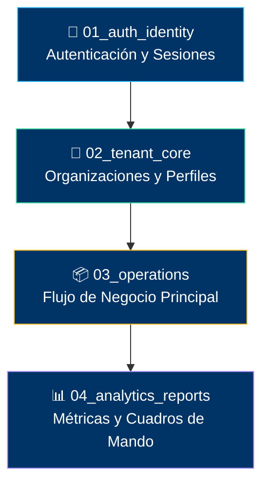

# 📋 Documento Rector de Requerimientos de Producto (PRD)

> **Proyecto:** `{{PROJECT_NAME}}`  
> **Dominio:** `{{PROJECT_DOMAIN}}`  
> **Versión:** 1.0.0  
> **Autor Líder:** Product Manager Lead (Fase 1)  
> **Estado:** APROBADO (Stage-Gate 1)  
> **Fecha de Emisión:** 2026-10-07  

---

## 1. Visión y Resumen Ejecutivo
- **Problema de Negocio:**  
  [Detallar el problema, cuello de botella o necesidad crítica que da origen a la solución en el dominio de {{PROJECT_DOMAIN}}].
- **Solución Propuesta:**  
  [Descripción de la solución de software moderna, multi-tenant y reactiva].
- **Objetivos SMART del Sistema:**  
  1. Reducir la fricción y tiempo de captura operativa en un 80% mediante interfaces guiadas y validación instantánea.  
  2. Garantizar 100% de trazabilidad forense e inmutabilidad en operaciones críticas de negocio.  
  3. Asegurar latencia p95 menor a 200ms en el 100% de los endpoints transaccionales.  

---

## 2. Marco Regulatorio y Reglas Inmutables de Dominio
- **Normativa y Estándares de la Industria:**  
  [Definir leyes, normativas de privacidad o estándares obligatorios del dominio].
- **Aislamiento de Información:**  
  Cero exposición de datos entre organizaciones/tenants distintos (Anti-IDOR estricto).

---

## 3. Matriz de Actores y Perfiles de Acceso (RBAC)

| Perfil / Rol | Alcance de Permisos | Propósito Operativo |
| :--- | :--- | :--- |
| `admin_general` | Acceso global a tenants, auditoría y catálogos | Configuración central del sistema |
| `manager` | Administración de su propia organización/tenant | Control operativo y aprobaciones |
| `operador` | Captura, edición y procesamiento diario | Trabajo nominal de negocio |
| `auditor` | Acceso de solo lectura a logs y registros históricos | Cumplimiento y verificación |

---

## 4. Desglose Inicial de Módulos del Sistema

*(Cada módulo se desglosa en detalle dentro de su respectiva carpeta en `docs/modules/[XX]/`).*

---

## 5. Requisitos No Funcionales (NFRs)
1. **Calidad de Tipado Estricto (Mandato Zero ANY):** Cero uso de `any` en TypeScript backend y frontend verificado mecánicamente por AST Parser.
2. **Arquitectura API-First:** Todos los endpoints deben tener un contrato Zod validado antes de escribir código.
3. **Resiliencia y Rendimiento:** Aislamiento transaccional ACID y paginación en consultas masivas.
4. **Diseño Visual de Clase Mundial:** Sistema de diseño institucional, modo claro accesible (WCAG 2.1 AA) y componentes coherentes.
