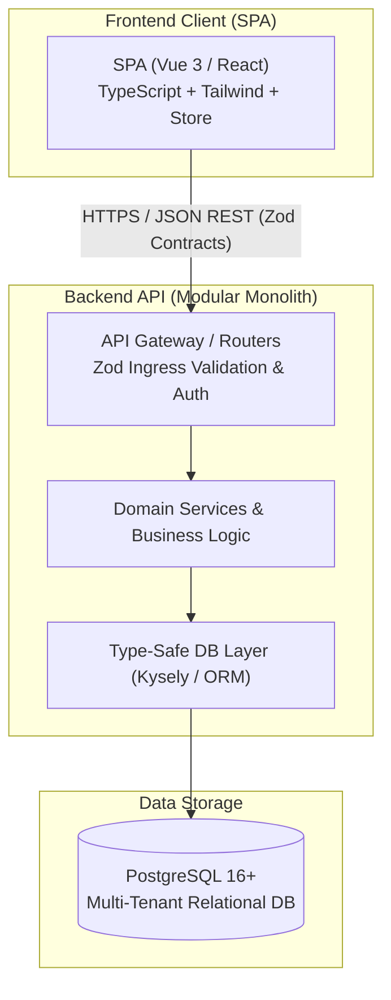
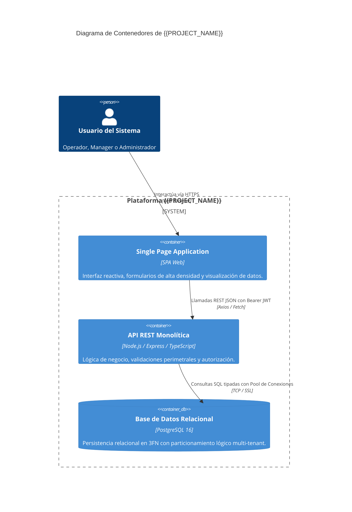

# 🏛️ Documento Rector de Arquitectura Técnica y Modelo C4

> **Proyecto:** `{{PROJECT_NAME}}`  
> **Dominio:** `{{PROJECT_DOMAIN}}`  
> **Versión:** 1.0.0  
> **Responsable:** Software Architect Lead (Fase 2)  
> **Estado:** PENDIENTE DE APROBACIÓN (Stage-Gate G2)  
> **Naturaleza:** Vivo (los cambios estructurales se justifican con un ADR)  
> **Última revisión:** {{INIT_DATE}}  

---

## 1. Topología del Sistema y Decisiones Estructurales

El sistema se estructura como un **Monolito Modular Moderno con desacople API-First** y tipado estricto bidireccional mediante contratos Zod.



### Principios Arquitecturales Clave:
1. **Cero Código Sin Contrato Previo (`AGENTS.md` §6):** Ningún endpoint se implementa sin un contrato formal en `docs/contracts/*.contract.ts`.
2. **Mandato Zero ANY Innegociable (`AGENTS.md` §6):** Se prohíbe taxativamente el uso de `any` en cualquier archivo `.ts`, `.tsx`, `.vue` o `.d.ts`.
3. **Envelope Canónico de Respuesta:**
   ```typescript
   // Respuesta Exitosa
   { success: true, data: T }

   // Respuesta de Error
   { success: false, error: { code: string, message: string, details?: unknown } }
   ```
4. **Seguridad Multi-Tenant Anti-IDOR:** El identificador del tenant (`tenant_id`) se extrae **exclusivamente del JWT autenticado** y nunca se confía en parámetros de URL o body para determinar la organización.

---

## 2. Modelo C4 — Diagrama de Contenedores (Nivel 2)



---

## 3. Estrategia de Migraciones y Modelado de Datos
- Las tablas se organizan bajo esquema relacional normalizado en Tercera Forma Normal (3FN).
- Toda tabla transaccional incluye `id UUID DEFAULT gen_random_uuid()`, `tenant_id UUID REFERENCES tenant(id)`, `created_at` y `updated_at`.
- Auditoría forense automatizada para cambios de estado críticos.
