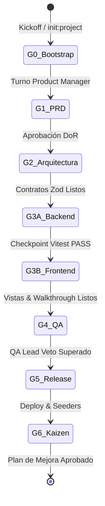

# 🗺️ Matriz Bidireccional de Versiones y Trazabilidad del Ciclo de Vida

> **Proyecto:** `{{PROJECT_NAME}}`  
> **Estándar Semántico:** SemVer 2.0.0 (`MAJOR.MINOR.PATCH`)  
> **Convención Git:** `[vX.Y.Z] tipo(scope): descripcion`  
> **Responsable:** DevOps Lead & Release Manager (Fase 5)  
> **Estado:** VIGENTE  
> **Naturaleza:** Vivo (se añade una fila por versión; las filas publicadas no se reescriben)  
> **Última revisión:** {{INIT_DATE}}  

---

## 1. Estado Consolidado de Módulos y Versiones

| Módulo ID | Nombre del Módulo | Versión Activa | Stage-Gate Actual | Estado de QA | Walkthrough Asociado |
| :---: | :--- | :---: | :---: | :---: | :--- |
| `00_starter` | Plantilla Base de Gobernanza | `v1.0.0` | **Gate 5 (Release)** | ✅ PASS | [WALKTHROUGH.md](../walkthroughs/00_starter/v1.0.0/WALKTHROUGH.md) |
| `01_auth` | Autenticación y Sesiones | `v0.1.0` | **Gate 1 (PRD)** | ⏳ PENDIENTE | _(pendiente)_ |

---

## 2. Definición del Ciclo de Vida por Módulo

---

## 3. Registro Histórico de Entregas por Versión
- **v1.0.0** (2026-10-07): Lanzamiento inicial de la plantilla rectora universal de desarrollo multiagente.
