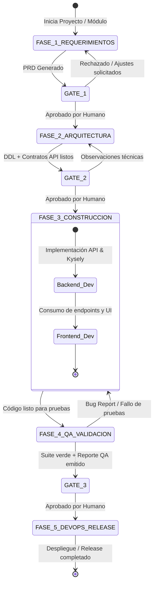

# 🧭 00_ORCHESTRATOR — Protocolo Maestro de Orquestación y Gobernanza Multiagente

> **Propósito:** Definir el ciclo de vida, la máquina de estados, los puntos de control ("Stage-Gates") y las reglas de interacción entre los agentes especializados del SDLC.  
> **Rol del Orquestador:** Garantizar el cumplimiento del proceso, evitar el *context drift*, validar los artefactos generados y coordinar la intervención del Director/Stakeholder Humano.

---

## 1. Principios Rectores del Sistema Multiagente

1. **Principio de Especialización Estricta:**  
   Ningún agente asume responsabilidades fuera de su dominio. Un *Frontend Engineer* no define contratos de base de datos; un *Product Manager* no escribe código de producción.

2. **Principio del Disco como Fuente Única de Verdad (Single Source of Truth):**  
   La memoria conversacional de un chat es efímera. La comunicación entre agentes se realiza **exclusivamente mediante artefactos versionados** en el repositorio (`docs/`, `src/`, `tests/`).

3. **Inmutabilidad de Fases Previas sin Aprobación:**  
   Un agente posterior no puede contradecir los artefactos de un agente anterior. Si durante el desarrollo se descubre un vacío en los requerimientos o en la arquitectura, se dispara un **Ciclo de Retroalimentación Formal (Feedback Loop)** hacia el agente responsable.

4. **Human-in-the-Loop en Stage-Gates:**  
   El Director Humano es la máxima autoridad. Ningún paso entre fases principales se ejecuta sin su aprobación explícita.

---

## 2. Máquina de Estados del SDLC Multiagente

---

## 3. Matriz de Agentes, Responsabilidades y Artefactos

| Fase | Agente Responsable | Carpeta del Agente | Artefacto de Entrada (Inputs) | Artefacto de Salida (Outputs) |
| :--- | :--- | :--- | :--- | :--- |
| **00** | **Orquestador Central** | `multiAgents/00_orchestrator/` | Petición del Humano | Estado del proyecto, asignación de tareas |
| **01** | **Product Manager (PM)** | `multiAgents/01_product_manager/` | Visión del Humano, Normativa | `docs/01_prd.md`, Historias de Usuario |
| **02** | **Software Architect** | `multiAgents/02_software_architect/` | `docs/01_prd.md` | `docs/02_architecture.md`, DDL, Contratos API |
| **03A** | **Backend Engineer** | `multiAgents/03_backend_engineer/` | `docs/02_architecture.md` | `backend/src/` (Kysely, Zod, Controladores) |
| **03B** | **Frontend Engineer** | `multiAgents/04_frontend_engineer/` | `docs/01_prd.md`, Contratos API | `frontend/src/` (Vue 3, Pinia, Tailwind) |
| **04** | **QA & Security Tester** | `multiAgents/05_qa_security_tester/` | Código en `src/`, Criterios PRD | `tests/`, `docs/03_qa_report.md` |
| **05** | **DevOps & Release** | `multiAgents/06_devops_release/` | Código probado, Esquema DB | Seeders, Docker/Config, `README.md` final |

---

## 4. Definición de "Stage-Gates" (Puntos de Control Innegociables)

### 🛑 Gate 1: Validación de Requerimientos (PM -> Arquitecto)
- **Checklist del Orquestador:**
  - [ ] ¿Están cubiertos los 21 módulos o el alcance acordado?
  - [ ] ¿Se especificaron las reglas normativas (Ley 115, Dec 1290 SIEE, Dec 1075)?
  - [ ] ¿Cada Historia de Usuario tiene criterios de aceptación en formato Given-When-Then?
- **Acción:** Solicitar firma al Director Humano.

### 🛑 Gate 2: Validación de Arquitectura (Arquitecto -> Desarrolladores)
- **Checklist del Orquestador:**
  - [ ] ¿El modelo relacional DDL (62 tablas) está completamente tipado y normalizado?
  - [ ] ¿Se definieron los contratos de endpoints con validaciones Zod?
  - [ ] ¿Está definida la matriz de seguridad RBAC por rol?
- **Acción:** Solicitar firma al Director Humano.

### 🛑 Gate 3: Validación de Calidad y Seguridad (QA -> DevOps)
- **Checklist del Orquestador:**
  - [ ] ¿El 100% de las pruebas automatizadas pasan en verde?
  - [ ] ¿Se verificó la inmutabilidad de periodos cerrados en notas y asistencia?
  - [ ] ¿No existen vulnerabilidades IDOR ni credenciales quemadas en el código?
- **Acción:** Solicitar firma al Director Humano antes del release.
