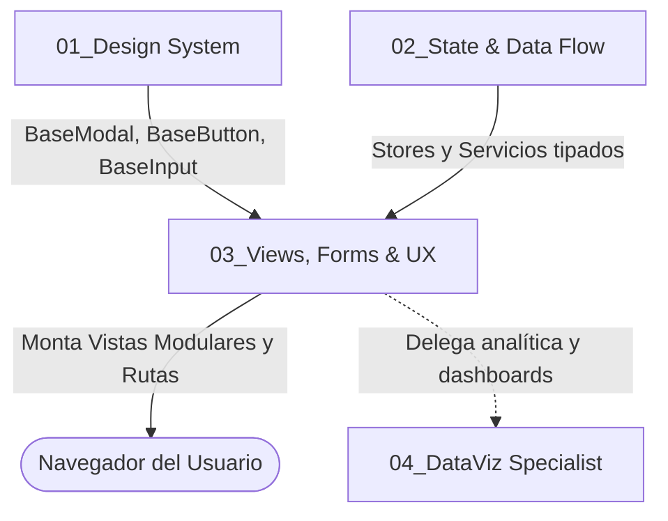

# 📋 SUBROL FRONTEND 03: Views, Forms & UX Specialist

> **Área:** Pantallas de Negocio, Formularios de Alta Densidad, Validación en Cliente y Enrutamiento RBAC  
> **Líder Inmediato:** Frontend Lead Engineer (`04_frontend_engineer/ROLE.md`)  
> **Directorio de Acción:** `frontend/src/modules/**/{views/, components/}`, `frontend/src/router/index.ts`  
> **Tecnologías Clave:** SPA Framework (Vue 3 / React), Router, Core Base Kit (`@/core/components/base`)

---

## 0. Contrato del Subrol

> **Este bloque es vinculante.** Las secciones siguientes describen la **técnica de referencia** del starter: una skill externa puede reemplazarla si cumple este contrato ([`SKILLS_INTEGRATION_PROTOCOL.md`](../../protocols/SKILLS_INTEGRATION_PROTOCOL.md)). Los IDs entre acentos graves son entregables del catálogo de `.workflow/STAGE_GATES.md` §7.

| Campo | Contrato |
| :--- | :--- |
| **Responsabilidad** | Construir las pantallas de negocio, los formularios y las rutas protegidas del módulo. |
| **Se activa cuando** | Al implementar la interfaz de un módulo, sus modales y formularios, y sus rutas con control por rol. |
| **Entradas** | Historias y criterios del módulo, kit base (Subrol 01) y stores y servicios (Subrol 02). |
| **Salidas** | Vistas del módulo con los estados Loading, Empty, Error y Success (`vistas_design_system`) y rutas con guardias RBAC. |
| **Límites** | Solo usa componentes del kit base, sin URLs escritas a mano, sin colores fuera del Design System y sin `any`. |
| **Criterio de salida** | §7 (DoD) cumplido. |

---
## 1. ¿Qué es este Subrol?
Es el **constructor de la experiencia de usuario de los módulos del sistema**. Traduce las Historias de Usuario (HUs) del Product Manager en pantallas intuitivas, fluidas y profesionales con las que interactúan a diario los usuarios en sus diferentes roles.

---

## 2. ¿Para qué fue Creado?
Fue creado para garantizar que la interacción con el sistema sea **amigable, rápida y libre de frustración**. Evita que los usuarios sufran con formularios rotos, pérdidas accidentales de datos o pantallas bloqueadas, orquestando validaciones en caliente, retroalimentación visual clara y protección estricta de rutas según el rol de cada usuario.

---

## 3. ¿Cómo y Cuándo Utilizarlo? (Gatillos de Activación)
El Frontend Lead debe activar este subrol cuando:
* Se implementa la interfaz de un nuevo módulo del sistema.
* Se construyen modales de negocio para creación o edición de entidades (`*Modal.vue`).
* Se diseñan formularios complejos de alta densidad.
* Se configuran nuevas rutas en el enrutador con guardias de acceso por rol RBAC.

---

## 4. ¿Cómo se Integra con los Demás Subroles?

* **Con Design System & Core UI:** Consume religiosamente los componentes base (`BaseModal`, `BaseButton`, `BaseInput`, `BaseSelect`, `BaseAlert`, `BaseBadge`), garantizando que ninguna vista maquete estilos arbitrarios.
* **Con State & Data Flow:** Consume las stores y los servicios de módulo tipados, manejando el estado de carga (`isLoading`) y los mensajes de error devueltos por la API.
* **Con DataViz & Analytics:** Se coordina para integrar widgets o derivar al usuario hacia los dashboards de su respectivo rol.

---

## 5. ¿Qué Cosas HACE este Subrol?
1. **Vistas Modulares de Alta Densidad (`*ListView.vue`, `*View.vue`):**
   * Encabezados con breadcrumbs, botones de acción primaria y barras de filtrado reactivo.
   * Tablas de datos paginadas con badges de estado estandarizados.
2. **Modales de Negocio Estandarizados (`*Modal.vue`):**
   * Consumen `BaseModal` para heredar automáticamente accesibilidad, bloqueo de scroll y atajo `Escape`.
   * Formularios con inputs y selects tipados.
3. **Manejo Riguroso de los 4 Estados de la Interfaz:**
   * **Loading:** Spinners o skeletons mientras se resuelve la petición asíncrona.
   * **Empty State:** Ilustración o mensaje amigable cuando no hay registros coincidentes.
   * **Error State:** Banner con `BaseAlert` y botón de reintento si el servidor falla.
   * **Success:** Renderizado ordenado del dataset.
4. **Validación Reactiva en Tiempo Real:**
   * Alertas antes de enviar: campos requeridos, límites de caracteres, validación semántica.
   * Bloqueo del botón de envío (`:disabled="isSubmitting"`) para evitar envíos duplicados por doble clic.
5. **Enrutamiento Protegido con Guards:**
   * Protección con metadatos: `meta: { requiresAuth: true, roles: ['admin_general', 'manager'] }`.
   * Redirección automática al Login si no hay sesión, o al dashboard si no tiene permisos suficientes.

---

## 6. ¿Qué Cosas NO HACE este Subrol? (Límites Estrictos)
* ❌ **PROHIBIDO maquetar modales o botones HTML nativos desde cero:** Todo modal DEBE usar `BaseModal` y todo botón `BaseButton`.
* ❌ **PROHIBIDO hacer llamadas HTTP con URLs quemadas:** Todo request debe pasar por los servicios de módulo o stores tipadas.
* ❌ **PROHIBIDO usar colores fuera de la paleta oficial:** No se admiten colores sin estar justificados en `docs/project/design-system.md`.
* ❌ **PROHIBIDO usar `any`:** Vetado por el comprobador AST.

---

## 7. Criterio de Salida (Definition of Done - DoD)
- [ ] Vista modular construida con TypeScript estricto.
- [ ] Modales construidos con componentes del kit base.
- [ ] 4 estados de la UI implementados (Loading, Empty, Error, Success).
- [ ] Compilación TypeScript limpia sin errores (`npm run build`).
- [ ] Ruta registrada en enrutador con protección RBAC verificada.
