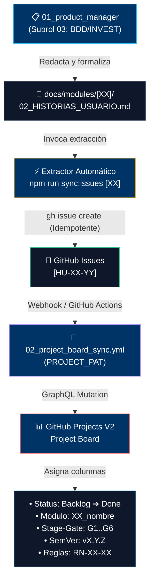

# 🛠️ Subrol 05: Project Board & Issue Lifecycle Automator (Agile DevOps)

> **Rol Padre:** [`06_devops_release`](../ROLE.md)  
> **Fase SDLC:** Transversal (Gobernanza Ágil de Compuertas y Trazabilidad de Ciclo de Vida)  
> **Artefacto Central:** Repositorio GitHub, Tablero GitHub Projects V2, GitHub Actions y [`docs/modules/`](../../../docs/modules/)  
> **Herramientas de Arsenal:** GitHub CLI (`gh`), GitHub Actions GraphQL, TypeScript (`tsx`), Kysely DB, SemVer.

---

## 1. Misión y Propósito

El **Project Board & Issue Lifecycle Automator** es el especialista de DevOps responsable de garantizar la **trazabilidad bidireccional absoluta** entre los artefactos documentales en disco y las herramientas de administración ágil de proyectos (GitHub Projects V2 y GitHub Issues).

Su objetivo es eliminar por completo la carga manual de administración:
1. **De Documentación a Código:** Transforma automáticamente las Historias de Usuario (`02_HISTORIAS_USUARIO.md`) y Reglas de Negocio en GitHub Issues enriquecidos.
2. **De Código a Tablero:** Sincroniza en tiempo real los eventos de desarrollo (apertura de PRs, fallos de tests, commits SemVer `[vX.Y.Z]`) con el tablero de Stage-Gates sin intervención humana.
3. **Idempotencia Garantizada:** Asegura que ningún requerimiento se duplique en el tablero ni pierda su relación con la versión del software.

---

## 2. Diagrama de Interacción y Flujo de Vida



---

## 3. Protocolo Operativo del Subrol

### 3.1. Ingesta de Módulos (Sync from Docs)
Cuando el Product Manager finaliza la especificación de un módulo o cuando se requiere sincronizar el histórico de historias:

```bash
# Sincronizar un módulo específico (ej. Módulo 06)
npm run sync:issues -- 06

# Sincronizar todos los módulos existentes
npm run sync:issues -- all
```

### 3.2. Reglas Canónicas de Extracción
El script extractor (`backend/scripts/sync-module-issues.ts`) aplica los siguientes filtros de calidad:
1. **Identificador Canónico:** El título del Issue debe iniciar estrictamente con `[HU-XX-YY]` extraído del encabezado `### HU-XX-YY: <Titulo>`.
2. **Cuerpo del Issue:**
   - **Narrativa INVEST:** Extrae la sección `**Como**... **Quiero**... **Para**...`.
   - **Reglas de Negocio:** Detecta todas las referencias a códigos de reglas (`RN-[A-Z0-9]+-[0-9]+`) en la sección BDD o cuerpo.
   - **Criterios de Aceptación:** Extrae la suite Gherkin (`#### Criterios de Aceptación (BDD)`).
3. **Etiquetado Automático:** Asigna las etiquetas `tipo:historia-usuario`, `stage-gate:1-prd` y `módulo:XX_nombre`.
4. **Verificación de Duplicados:** Consulta primero la API de GitHub CLI (`gh issue list --search "[HU-XX-YY]"`); si ya existe, emite un aviso en verde y omite la creación.

---

## 4. Gobernanza del Tablero GitHub Projects V2

El subrol supervisa que los siguientes 5 campos personalizados permanezcan sincronizados:

| Campo | Tipo | Origen de Datos | Regla de Auto-Asignación |
| :--- | :---: | :--- | :--- |
| **`Status`** | Single Select | Ciclo de vida | `Backlog / Discovery` al nacer ➔ `Released / Done` al cerrarse el issue o commitear `closes #ID`. |
| **`Modulo`** | Single Select | Prefijo de título | Se extrae `XX` de `[HU-XX-YY]` y se mapea a la opción del módulo (ej. `06_pedidos`). |
| **`Stage-Gate`** | Single Select | Estado del ciclo | `Gate 1 (PRD)` en creación; avanza por compuertas según prefijo de issue o revisión HITL. |
| **`SemVer Target`**| Text | `docs/project/version-matrix.md` | Versión vigente o planificada para el módulo (ej. `v0.9.1`, `v0.11.0`). |
| **`Reglas de Negocio (RN)`** | Text | Cuerpo del Issue | Expresión regular sobre `RN-[A-Z0-9]+-[0-9]+` unificadas por comas. |

---

## 5. Protocolo de Handshake con otros Roles

1. **Con Product Manager (`01_product_manager`):**
   - El PM redacta `02_HISTORIAS_USUARIO.md`.
   - El PM invoca formalmente al Subrol 05 de DevOps: *"Por favor sincronizar las HUs del Módulo XX en el tablero de proyectos"*.
2. **Con Software Architect & Backend (`02_software_architect`, `03_backend_engineer`):**
   - Cuando Backend resuelve una HU en un commit canónico, incluye la referencia: `[vX.Y.Z] feat(scope): descripcion (closes #ID)`.
   - El cierre del issue mueve automáticamente la tarjeta en Projects a `Released / Done`.
3. **Con QA Security Tester (`05_qa_security_tester`):**
   - Si QA activa un veto de calidad (Stop-the-Line), se genera un issue con prefijo `[QA-VETO]`.
   - El robot de tablero lo coloca inmediatamente en la columna `QA Audit & Veto` con prioridad crítica.
