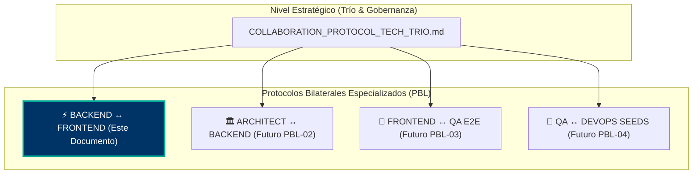
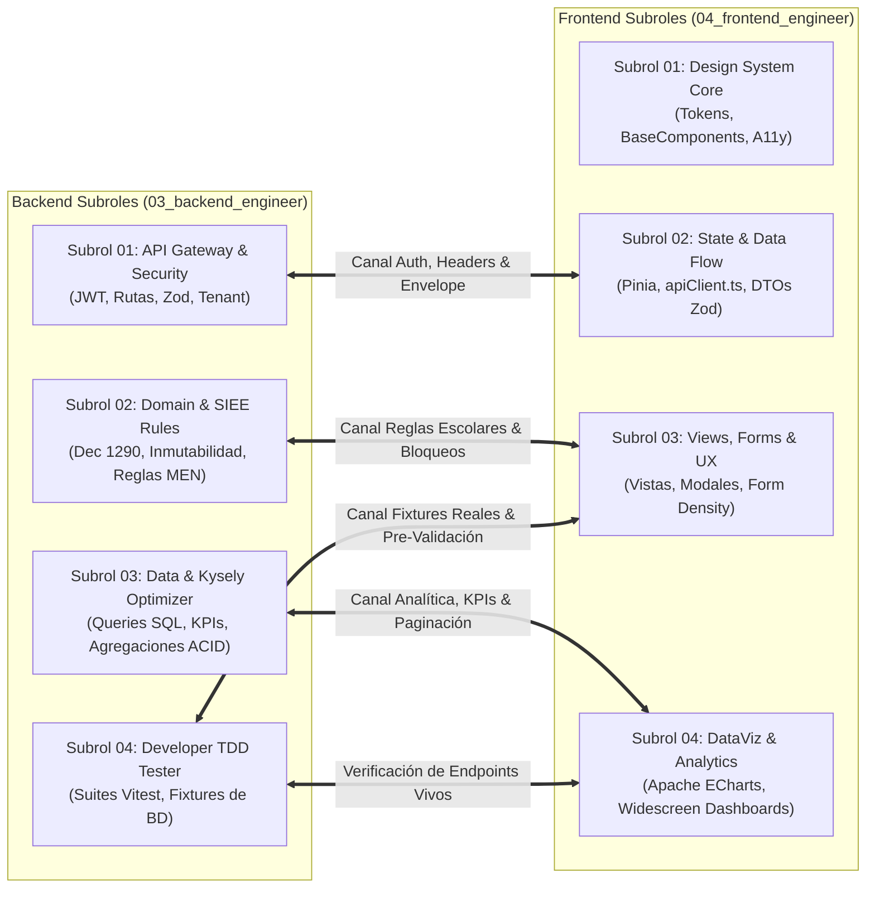

# ⚡ PROTOCOLO BILATERAL EXCLUSIVO: BACKEND ↔ FRONTEND (SUBROLES TÉCNICOS)
## Guía Canónica de Interacción, Acoplamiento y Relevo en Fase 3 de Construcción

> ```text
> ┌────────────────────────────────────────────────────────────────────────────────────────┐
> │ 🛑 ALERTA DE AUDIENCIA EXCLUSIVA — LEA ANTES DE CONTINUAR                              │
> ├────────────────────────────────────────────────────────────────────────────────────────┤
> │ 🎯 DESTINATARIOS EXCLUSIVOS:                                                           │
> │    • 🛠️ Backend Lead Engineer y su Kit de Subroles (01, 02, 03, 04)                    │
> │    • 🎨 Frontend Lead Engineer y su Kit de Subroles (01, 02, 03, 04)                   │
> │    • 👤 Director Humano / Tech Lead (Supervisión de Fase 3)                            │
> │                                                                                        │
> │ 🚫 ESTE DOCUMENTO NO APLICA A (OMITIR LECTURA SI USTED ES):                            │
> │    • 📋 Product Manager / PO  ➔ Su marco rector es docs/01_prd.md                      │
> │    • 🏛️ Software Architect   ➔ Su marco rector es docs/02_architecture.md y contracts/│
> │    • 🧪 QA Lead & Security    ➔ Su marco rector es docs/qa/ y docs/03_qa_report.md     │
> │    • 🚀 DevOps & Release      ➔ Su marco rector es multiAgents/06_devops_release/      │
> │                                                                                        │
> │ 📌 CLASIFICACIÓN DEL DOCUMENTO:                                                        │
> │    Estándar Canónico de Protocolos Bilaterales Inter-Líderes (Familia PBL).            │
> │    Este documento define la interacción peer-to-peer exclusiva de desarrollo técnico.  │
> └────────────────────────────────────────────────────────────────────────────────────────┘
> ```

---

## 1. Contexto y Taxonomía: La Familia de Protocolos Bilaterales (PBL)

En proyectos complejos de alta densidad institucional como **AcademiaNeiva**, las guías globales (como `COLLABORATION_PROTOCOL_TECH_TRIO.md`) definen el marco estratégico general. Sin embargo, cuando dos áreas técnicas entran a la fase de construcción activa, necesitan un **manual de operaciones milimétrico bilateral** que resuelva los roces diarios de implementación sin involucrar a roles que no participan directamente en ese código.

Este protocolo es el primer artefacto de la serie de **Protocolos Bilaterales de Líderes (PBL)**:



---

## 2. El Principio del "Espejo Técnico": Mapeo Subrol a Subrol

Cada subrol del Backend tiene un **interlocutor natural** en el Frontend. No se trabaja de manera genérica ("backend le pasa a frontend"), sino de **especialista a especialista**:



---

## 3. Las 4 Vías Maestras de Sincronización Bilateral

### Vía 1: Subrol 01 Backend ⇄ Subrol 02 Frontend (Seguridad, Headers y Envelope)
* **Objetivo:** Garantizar que las solicitudes HTTP fluyan con autenticación inmutable, multi-tenancy y un formato de envoltorio idéntico.
* **Compromisos de Backend (01):**
  1. Todo endpoint protegido exige el middleware `requireAuth` e inyecta `req.user.colegioId`.
  2. Ningún controlador responderá con JSON plano desordenado. Todas las respuestas DEBEN usar el Envelope Canónico:
     ```json
     { "success": true, "data": { ... }, "message": "Mensaje opcional" }
     ```
  3. Todo error de validación o rechazo devolverá:
     ```json
     { "success": false, "error": { "code": "VALIDATION_FAILED", "message": "...", "details": [ ... ] } }
     ```
* **Compromisos de Frontend (02):**
  1. `apiClient.ts` inyecta automáticamente el token Bearer desde `useAuthStore`.
  2. Manejo global de expiración de sesión (código `401` redirige a `/login` sin recargar la página bruscamente).
  3. Los stores de Pinia extraen siempre `response.data.data` y nunca acceden a propiedades directas sin desenvolver el Envelope.

---

### Vía 2: Subrol 02 Backend ⇄ Subrol 03 Frontend (Reglas SIEE y Formularios)
* **Objetivo:** Coherencia absoluta entre la lógica de negocio escolar colombiana y los formularios de usuario.
* **Compromisos de Backend (02):**
  1. Si un periodo académico está `CERRADO`, cualquier intento de escritura (`POST`, `PUT`, `DELETE`) en calificaciones o asistencia debe responder con código HTTP `409 Conflict` y código interno `"PERIOD_CLOSED_CONFLICT"`.
  2. Las escalas valorativas (1.0 a 5.0 según SIEE Dec 1290) se validan con Zod en backend.
  3. Las restricciones del Decreto 1850 (topes de intensidad horaria docente) se aplican estrictamente en el servicio de asignación.
* **Compromisos de Frontend (03):**
  1. **UX Proactiva:** Los formularios deben deshabilitar campos y botones de acción (o mostrar un banner informativo `"Periodo Cerrado - Modo Lectura"`) cuando el periodo esté cerrado, antes incluso de enviar la petición.
  2. **Validación Espejo:** Si el backend valida `min(1.0).max(5.0)`, el input en Vue debe usar `type="number" min="1" max="5" step="0.1"`, previniendo que el usuario envíe valores inválidos.
  3. **Visualización de Errores de Negocio:** Si backend responde `409`, la vista debe capturar `error.message` y mostrar una alerta accesible (`role="alert"`), no un error genérico `"Ocurrió un error"`.

---

### Vía 3: Subrol 03 Backend ⇄ Subrol 04 Frontend (Analítica, KPIs y ECharts)
* **Objetivo:** Dashboards ejecutivos fluidos, con datos 100% reales de PostgreSQL y cero impacto negativo en la base de datos.
* **Compromisos de Backend (03):**
  1. Los endpoints analíticos (`/api/v1/dashboard/...`) deben realizar agregaciones SQL eficientes con Kysely (`count`, `groupBy`, filtros de índice `colegio_id`).
  2. NUNCA enviar arrays masivos de miles de filas para que el frontend los cuente en JavaScript. El cálculo estadístico se hace en PostgreSQL.
  3. Estructurar el DTO de respuesta en formatos amigables para gráficos (ej: `{ categorias: string[], valores: number[] }` o series de objetos `{ name, value }`).
* **Compromisos de Frontend (04):**
  1. Conectar las gráficas Apache ECharts **exclusivamente a los datos devueltos por el backend**. Prohibido el uso de valores inventados (`[45, 80, 20]`) en producción.
  2. Implementar estados de carga (`SkeletonLoader` o spinner oficial) mientras el endpoint de Kysely responde.
  3. Gestionar estados vacíos con gracia cuando la institución no tenga registros históricos.

---

### Vía 4: Subrol 04 Backend ⇄ Subroles 03/04 Frontend (Fixtures Reales y Certificación Previa)
* **Objetivo:** El desarrollador de Frontend NUNCA debe integrar contra un endpoint "teórico" que falla al primer llamado.
* **Compromisos de Backend (04):**
  1. Antes de declarar un endpoint como disponible para Frontend, el Subrol 04 de Backend DEBE haber ejecutado su suite de integración interna en Vitest (`npm test`).
  2. La suite debe certificar al menos:
     - Caso de éxito (200 / 201).
     - Caso de validación fallida (400 / 422).
     - Caso de autorización rechazada (401 / 403).
  3. En la entrega se proporciona un ejemplo de payload real y comando cURL o archivo Bruno para prueba inmediata.
* **Compromisos de Frontend (03/04):**
  1. Verificar que el backend esté corriendo en local y que el seeder (`npm run seed`) provea los registros necesarios antes de reportar un fallo de integración.

---

## 4. Matriz de Relevo (Handshake) en WORKLOG.md

Cuando el Backend Lead y sus subroles finalizan un endpoint o módulo, **DEBEN** dejar en su `WORKLOG.md` el siguiente bloque estandarizado para consumo del Frontend Lead:

```markdown
### 🤝 RELEVO TÉCNICO BILATERAL: BACKEND ➔ FRONTEND
- **Módulo / Característica:** [Ej: Módulo 11 - Calificaciones]
- **Subroles de Backend Actores:** 01 (Gateway) + 02 (SIEE) + 03 (Kysely) + 04 (TDD)
- **Subroles de Frontend Receptores:** 02 (State) + 03 (Views)
- **Contrato Zod Oficial:** `docs/contracts/11_calificaciones.contract.ts`
- **Endpoints Verificados en Vitest (100% PASS):**
  - `GET  /api/v1/calificaciones/periodo/:periodoId` -> Retorna lista con Envelope.
  - `POST /api/v1/calificaciones/lote` -> Registra calificaciones masivas (ACID).
- **Ejemplo de Payload Válido:**
  ```json
  {
    "periodoId": "d3b07384-...",
    "notas": [
      { "matriculaId": "a1b2...", "asignaturaId": "c3d4...", "nota": 4.2 }
    ]
  }
  ```
- **Códigos de Error SIEE Previstos:**
  - `PERIOD_CLOSED_CONFLICT` (409): Periodo cerrado por rectoría.
  - `ESCALA_OUT_OF_BOUNDS` (422): Calificación inferior a 1.0 o superior a 5.0.
- **Estado de Pruebas:** 14/14 tests de integración PASS en `tests/modules/11_calificaciones.test.ts`.
```

---

## 5. Protocolo de "Solicitud de Extensión Bilateral" (Frontend ➔ Backend)

Si durante la construcción de la pantalla el Frontend Subrol 03 o 04 nota que la interfaz requiere un dato adicional no contemplado:

1. **PROHIBICIÓN ESTRICTA:** Queda terminantemente prohibido simular el campo mediante strings fijos en el template Vue (Antipatrón Mock Oculto).
2. **ACCIÓN OBLIGATORIA:** El Frontend Lead agrega una notificación formal en el `WORKLOG.md` del Backend:
   ```markdown
   > ⚡ **SOLICITUD DE EXTENSIÓN BILATERAL (FRONTEND ➔ BACKEND)**
   > **Módulo:** [Número y Nombre]
   > **Endpoint:** `GET /api/v1/...`
   > **Campo(s) Requerido(s):** `nombreCampo: tipo` (Ej: `porcentajeInasistencia: number`)
   > **Justificación de UX:** Requerido para colorear la fila en rojo si supera el 20% según Dec. 1290.
   > **Subrol Frontend Solicitante:** 03 (Views, Forms & UX) / 04 (DataViz)
   ```
3. **RESPUESTA DE BACKEND:** El Backend Lead delega en **Subrol 03 (Kysely)** y **Subrol 01 (Gateway/Zod)** para actualizar la consulta SQL y el DTO, re-ejecuta Vitest y notifica al Frontend.

---

## 6. Las 5 Reglas Inviolables de la Interacción Bilateral

1. ❌ **CERO MOCK FANTASMA:** Todo dato consumido en las vistas debe provenir de `apiClient.ts` conectado a un endpoint activo de Express respaldado por PostgreSQL.
2. ❌ **ENVELOPE SAGRADO:** Si un endpoint devuelve un array u objeto sin envoltorio `{ success: true, data: ... }`, Frontend debe rechazar la integración y pedir la corrección inmediata a Backend Subrol 01.
3. ❌ **CÓDIGOS HTTP SEMÁNTICOS:** Prohibido responder `HTTP 200 OK` con un `{ success: false, error: ... }`. Los errores de validación son `400/422`, de autenticación `401/403` y de colisión de reglas escolares `409`.
4. ❌ **ZOD CONTRACT FIRST:** Ningún subrol inventa tipos manuales en interfaces aisladas. La única fuente de la verdad para DTOs son los archivos en `docs/contracts/`.
5. ❌ **AUTO-TESTING PREVIO OBLIGATORIO:** Backend no puede hacer entrega a Frontend sin haber corrido `npm test` con resultado verde en su módulo. Frontend no puede reportar un error sin verificar primero la consola de red del navegador y la respuesta JSON del servidor.
